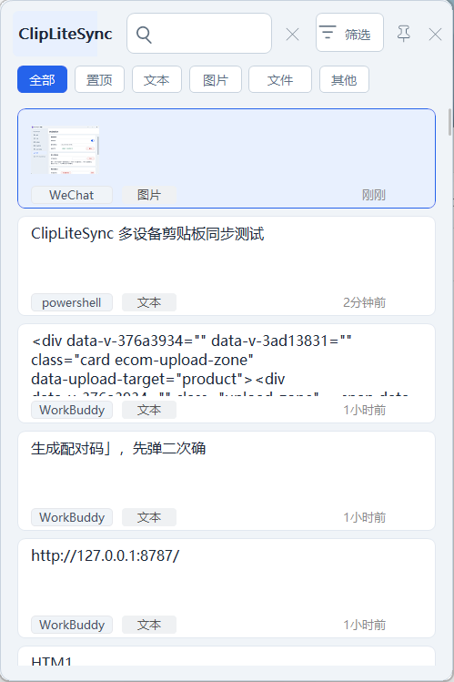
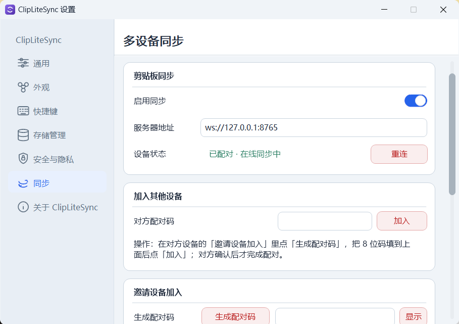
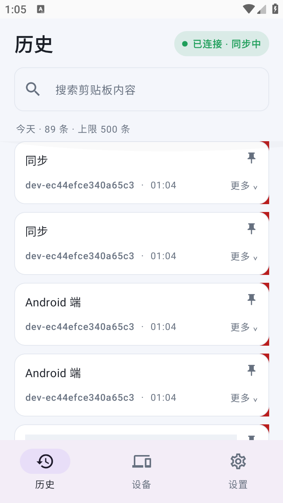
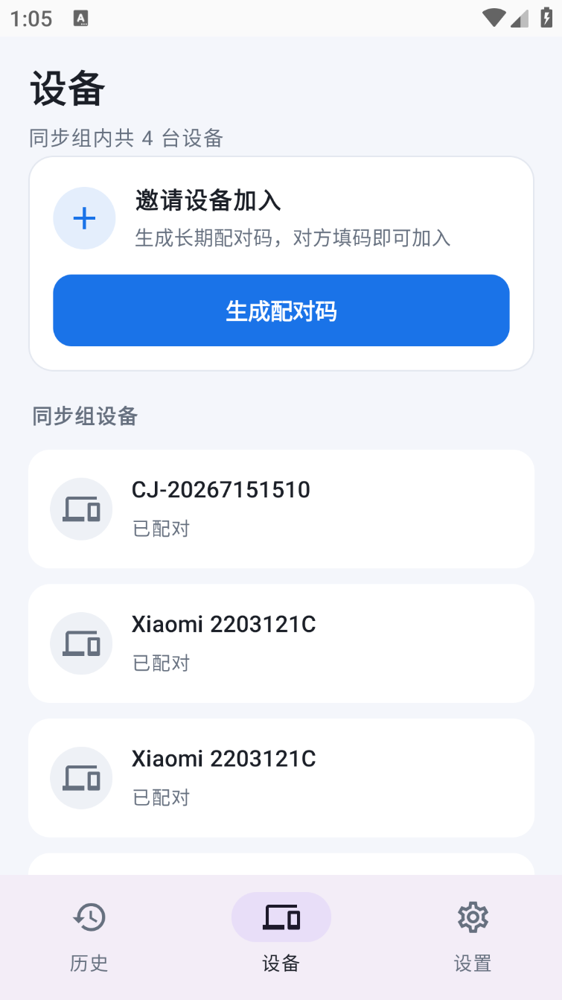
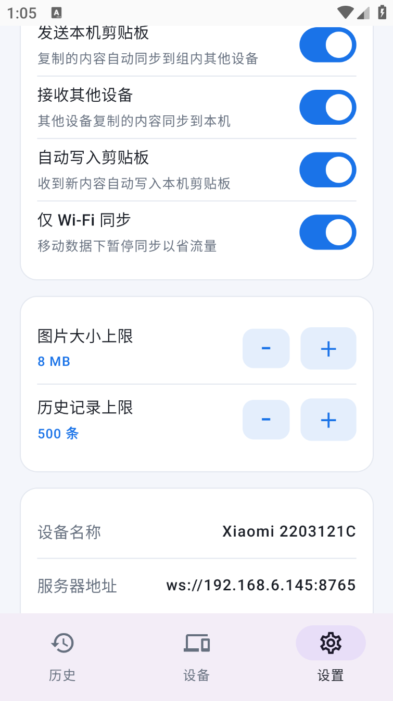

# ClipLiteSync

> **ClipLiteSync** 是一款**多设备剪贴板同步**工具，同时保留了一个轻量、省内存的 Windows 剪贴板历史管理器。它把「电脑上复制、手机上粘贴」与「手机上复制、电脑上粘贴」变成日常工作流。
>
> 本项目 **fork 自 [wxh-777/ClipLite](https://github.com/wxh-777/ClipLite)**（一款仅支持 Windows 的原生剪贴板历史工具）。在原项目基础上扩展了多设备剪贴板同步能力，新增了 Go 同步服务端与 Android 客户端；原项目的剪贴板历史功能得以完整保留。

[English](README.en.md) · [使用说明](USAGE.md) · [同步操作指南](docs/sync-user-guide.md) · [同步协议](docs/clip-sync-protocol.md) · [更新日志](CHANGELOG.md)

当前版本：**2.0.1**

---

## 架构总览

ClipLiteSync 由三部分组成：

```
┌───────────────┐   WebSocket / REST    ┌──────────────────┐
│ Windows 客户端 │ ───────────────────▶ │   Go 同步服务端    │
│ (C++ / Win32)  │                      │ (单二进制, :8765) │
└───────────────┘                      └────────┬─────────┘
        ▲                                        │
        │            WebSocket / REST             │
┌───────┴────────┐                              │
│ Android 客户端  │ ◀────────────────────────────┘
│ (Kotlin/Compose)│
└────────────────┘
```

| 端 | 技术栈 | 目录 | 产物 |
|---|---|---|---|
| 同步服务端 | Go（单二进制，无数据库） | `server/` | `clipsync-server.exe` |
| Windows 客户端 | C++17 / Win32 / GDI+ | `src/` `include/` `resources/` | `ClipLite.exe` |
| Android 客户端 | Kotlin / Jetpack Compose | `mobile-android/` | `clipsync.apk` |

多台设备（Windows / Android 任意组合）连接到同一台服务端、加入同一「同步房间」后，剪贴板内容即自动互相同步。支持多房间隔离：不同房间的设备互不相通。

## 截图

| Windows 客户端 | |
|---|---|
|  |  |

| Android 客户端 | | |
|---|---|---|
|  |  |  |

---

## 功能特性

### 多设备剪贴板同步（本项目的核心能力）

- **跨平台双向同步**：文本、图片在 Windows 与 Android 之间实时同步。
- **房间制配对**：设备填服务器地址后「一键建房」成为房主；其他设备填 8 位永久配对码申请加入，房主确认后即入组。
- **永久配对码**：8 位大写字母+数字（去掉了易混淆的 0/1/I/O），长期有效、可重复使用。
- **自动重连与补发**：断网自动指数退避重连；重连后按 `last_seq` 补发离线期间缺失的事件。
- **多房间隔离**：同一服务端可承载多个互不相通的同步组。
- **设备管理**：房主可查看、移除自己引入的设备；变更验证码会撤销旧码并踢出旧设备。
- **防回环**：远端注入的内容不会再次上行，杜绝 A→B→A 循环。
- **去重**：`syncId` 幂等 + 内容 `hash` 查重，避免重复入库。
- **安全限制**：加入接口按 IP 限速（每分钟 5 次）、连续失败锁定（10 次锁 15 分钟）。

### 剪贴板历史（继承自 ClipLite）

- 使用 `Alt+V` 打开历史窗口，可选替换 Windows 的 `Win+V`。
- 捕获并恢复纯文本、HTML、文件列表、图片（DIB/DIBV5），文件列表中的图片按需显示缩略图。
- 支持搜索、按类型/时间/长度/来源应用筛选，置顶、删除、清空、自动粘贴。
- 图片与长文本独立预览浮窗，支持滚轮缩放、拖拽查看。
- 六种主题（浅色/深色/护眼绿/护眼夜间/纸张暖色/午夜蓝）+ 自定义主题编辑器。
- 浅色/深色、中英双语界面，常驻系统托盘，低内存占用（闲时约 0.7 MB）。
- 支持最大记录数/磁盘空间/保留天数/单条大小限制，置顶记录不自动清理。
- 支持按来源应用忽略、敏感文本自动过期、Windows DPAPI 用户级加密。
- 普通安装模式与便携模式。

---

## 快速开始

### 1. 部署服务端

在一台常开的机器（Windows / NAS / Linux VPS 均可）上运行服务端：

```pwsh
# Windows
$env:CLIPSYNC_ADMIN_PASSWORD = "<你的管理密码>"
$env:CLIPSYNC_DATA_DIR = "./data"
.\clipsync-server.exe
```

```bash
# Linux（交叉编译：GOOS=linux go build）
CLIPSYNC_ADMIN_PASSWORD="<你的管理密码>" ./clipsync-server
```

服务端默认监听 `:8765`。详细的环境变量说明见 [server/README.md](server/README.md)。

### 2. 接入客户端

在每台设备的「设置 → 同步」页（Windows）或「配对向导」（Android）：

1. 填「服务器地址」，如 `ws://192.168.1.10:8765`（局域网）或 `wss://your.domain`（公网，需 TLS 反代）。
2. **第一台设备**：直接点「生成配对码」→ 自动在服务端注册并创建一个新房间。
3. **其他设备**：填第一台设备生成的 8 位配对码 → 点「加入」→ 房主在「待确认」里接受。

完整操作指引（含多分组、移除设备、常见问题）见 [docs/sync-user-guide.md](docs/sync-user-guide.md)，配对与连接流程原理见 [docs/pairing-flow.md](docs/pairing-flow.md)。

> **公网部署提示**：公网请使用 `wss://`（推荐 Caddy/Nginx 做 TLS 反代），不要直接暴露明文 `ws://`。开放注册默认开启，公网部署建议设 `CLIPSYNC_DISABLE_REGISTER=1` 关闭，改用管理员创始码引导首台设备。

---

## 下载

Releases 提供以下产物（见 [Releases 页面](https://github.com/jayxtt999/ClipLiteSync/releases)）：

- `ClipLite.exe` — Windows 客户端（x64）
- `clipsync-server.exe` — 同步服务端（Windows x64）
- `clipsync.apk` — Android 客户端

> Android 端当前为**调试签名包**（未上架商店），安装时需允许「未知来源」。下载后直接安装即可使用。

---

## 构建

### 同步服务端（Go）

```bash
cd server
go build -o clipsync-server.exe .
```

要求 Go 1.20+。国内拉依赖可设 `GOPROXY=https://goproxy.cn,direct`。

### Windows 客户端（C++ / Win32）

要求 Windows、Visual Studio 2019+（含 MSVC 与 Windows SDK）、CMake 3.15+，目标 x64：

```pwsh
cmake -S . -B build-x64 -A x64 -DBUILD_TESTING=ON
cmake --build build-x64 --config Release
ctest --test-dir build-x64 -C Release --output-on-failure
```

### Android 客户端（Kotlin / Compose）

要求 JDK 17+、Gradle 8.9+（本仓库未内置 Gradle Wrapper，请使用本机 Gradle）：

```bash
cd mobile-android
gradle :app:assembleDebug
```

产物输出为 `app/build/outputs/apk/debug/clipsync.apk`。最低支持 Android 8.0（API 26）。

---

## 快捷键（Windows 端）

- `Alt+V`：打开剪贴板历史
- `Enter` / 鼠标单击：粘贴当前项目
- `Ctrl+Shift+V`：粘贴为纯文本
- `Ctrl+Shift+R`：粘贴为富文本
- `Delete`：删除当前项目
- `Esc`：关闭历史窗口
- `F10`：打开设置

## 命令行参数（Windows 端）

- `ClipLite.exe --history`：启动并打开历史窗口
- `ClipLite.exe --settings`：启动并打开设置窗口
- `ClipLite.exe --exit`：请求已运行实例退出

---

## 文档

| 文档 | 说明 |
|---|---|
| [USAGE.md](USAGE.md) | Windows 端剪贴板历史使用说明（简单易懂版） |
| [docs/sync-user-guide.md](docs/sync-user-guide.md) | 多设备同步操作指南 |
| [docs/pairing-flow.md](docs/pairing-flow.md) | 配对与连接流程说明 |
| [docs/clip-sync-protocol.md](docs/clip-sync-protocol.md) | 同步协议与接口定义 |
| [docs/mobile-requirements.md](docs/mobile-requirements.md) | 移动端需求书 |
| [docs/mobile-dev-guide.md](docs/mobile-dev-guide.md) | Android 技术方案 |
| [CONTRIBUTING.md](CONTRIBUTING.md) | 贡献指南 |
| [CHANGELOG.md](CHANGELOG.md) | 更新日志 |

---

## 数据和隐私

- Windows 端历史默认存于 `%LOCALAPPDATA%\ClipLite\`，支持 DPAPI 加密、敏感内容过期、便携模式。
- Android 端剪贴板历史仅存本机，token 使用 Android Keystore 加密存储。
- 同步服务端默认**明文传输**（局域网自用可接受）；公网请务必使用 `wss://`。应用层不加密内容，服务端可见明文。
- 服务端设备数据存于 `CLIPSYNC_DATA_DIR`（默认 `./data`）下的 JSON 文件，无数据库依赖。

## 许可证

ClipLiteSync 沿用上游 [wxh-777/ClipLite](https://github.com/wxh-777/ClipLite) 的许可证：[PolyForm Noncommercial License 1.0.0](LICENSE.md)。允许个人、教育、研究和其他非商业用途使用、学习、修改和分发，但禁止商业用途与商业分发。需要商业使用请先取得版权所有者书面授权。

## 反馈和安全问题

普通问题请提交 [Issue](https://github.com/jayxtt999/ClipLiteSync/issues)。安全漏洞请先阅读 [SECURITY.md](SECURITY.md)，不要公开发布利用细节。
